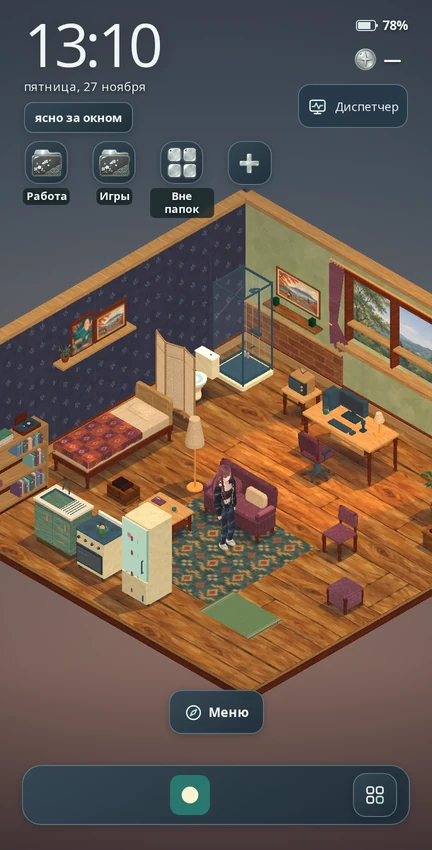
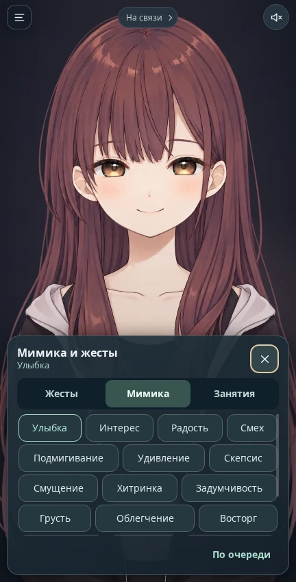

# Ева для Android

Личная ИИ-помощница с текстовым и голосовым чатом Codex, экранным питомцем и «Домом Евы». Всё работает из одного Android-приложения. Дом открывается из меню чата и при желании назначается домашним экраном в настройках Android.

<p>
  
  
</p>

Ева запускает Codex app-server и веб-интерфейс в собственной среде Linux ARM64. Android отвечает за ввод, озвучку, камеру, уведомления и управление интерфейсом. Поддержка действий зависит от разрешений и версии Android.

В каталоге «Вне папок» обычное касание запускает приложение. Через «⋯» или долгое нажатие можно добавить значок на рабочий стол, переместить его в папку или убрать с рабочего стола. Отдельные значки можно переставлять перетаскиванием.

В меню «Рабочий стол и питомец» тема и экранный питомец включаются отдельно. На рабочем столе Ева живёт в комнате. Мебель можно двигать и поворачивать, а погода и время суток меняют вид за окном. В других приложениях касание питомца открывает мини-чат рядом с аватаром, а кнопка микрофона добавляет диктовку в черновик.

## Комната, игры и портрет

Поставь два пальца на комнату. Разводи и своди их, чтобы приблизить или отдалить камеру, и поворачивай, чтобы обойти комнату вокруг Евы. Жесты можно совместить. Те же действия доступны в «Меню → Комната → Обстановка → Ракурс и масштаб». У комнаты 16 рисованных материалов. Исходные листы и порядок сборки текстур лежат в [каталоге материалов](art/room-materials/README.md).

В «Комната → Занятия» можно выбрать дело для Евы. Стул, стол, кровать, руки и предметы используют общие координаты. На экране компьютера Ева сама играет в платформер, собирает огоньки, встречает противников и переходит между уровнями. Чат стрима подхватывает события партии. Нажатие на монитор или на стрелку у заголовка чата разворачивает ту же игру и переписку. По желанию можно включить импровизации модели в разделе «Комната».

В основном чате Ева остаётся рисованным 2D-персонажем. Анимации глаз, мимики, жестов и речи сохраняют её пропорции. При обычной прокрутке сообщения плавно исчезают у шеи. Раскрытие сообщения позволяет прочитать его целиком. «Диспетчер» на рабочем столе открывает показатели телефона и списки доступных Android приложений и служб.

## Исходники

- `app` — Android-модуль, экранный питомец, интерфейс и симуляция «Дома».
- `runtime/codex-mobile` — чат, голос, интеграция с Codex, заметки, задачи и инструменты телефона.
- `runtime/eva-workshop` — мастерская. Автоматические запуски выключены на чистой установке.
- `tests` — проверки разговора, интеграции Codex, питомца и симуляции.

Характер редактируется в `runtime/codex-mobile/persona.md`. Ева передаёт инструкции через app-server при создании и возобновлении чата, а также при запуске каждого ответа. Голосовая реплика в режиме Codex проходит через тот же чат, что и текстовая. Выбранные вручную внешние модели получают тот же характер через системную инструкцию и работают без инструментов телефона.

Пока Codex отвечает, кнопка «Уточнить сейчас» передаёт текст и вложения в текущую работу. С клавиатуры можно нажать Ctrl+Enter. Обычная отправка во время ответа добавляет сообщение в очередь.

## Установка и сборка из исходников

Готовый подписанный APK для Android ARM64 (Android 8 и новее) доступен в [релизах проекта](https://github.com/ilyabdmgame-pixel/eva-android/releases). При первом запуске Ева распакует среду и предложит войти в свой аккаунт Codex. Публичное приложение использует идентификатор `org.evaassistant.app` и собственное хранилище Android.

Выпуск распространяется через GitHub и сохраняет target SDK 29 для доступа существующих профилей к общей папке Documents. Переход к современному target SDK потребует миграции работы с этим хранилищем.

Для самостоятельной сборки на Linux нужны Python 3.11+, JDK 17, Gradle 8.9, Android SDK 35 с Build Tools 35.0.0 и LLVM 15. Из корня репозитория выполни:

```sh
mkdir -p local-runtime
python3 tools/prepare_public_rootfs.py --output local-runtime/rootfs.pack
python3 tools/native_provenance.py fetch local-runtime --llvm-strip llvm-strip-15
curl -fL --retry 4 -o local-runtime/vosk-ru-small.zip https://alphacephei.com/vosk/models/vosk-model-small-ru-0.22.zip
echo '961d5ff98a17f4aa6de69864d0aa71fa5bac682301d2b5d17a3f24c5c99a46d4  local-runtime/vosk-ru-small.zip' | sha256sum -c -
gradle :app:assembleDebug
```

Состав чистой Linux-среды, версии пакетов и порядок проверки описаны в [инструкции по ARM64](tools/PUBLIC_ROOTFS.md). Gradle принимает другой каталог зависимостей через `-PevaRuntimeDeps=/path/to/deps`. Для работы с исторической установкой сохранён отдельный инструмент `tools/import_legacy_runtime.py`. Публичный выпуск собирается из зафиксированных загрузок с проверкой SHA-256. [Сборка и подпись релиза](tools/distribution/README.md).

По умолчанию Ева использует системный голос Android. Silero доступен при наличии рантайма и весов модели в локальной Linux-среде.

## Проверки

```sh
bash tools/check.sh
```

Для проверки обычных экранов в настольном Chromium нужны Node.js 22 и Chrome. Скрипт поднимает изолированный профиль с тестовым мостом Android, открывает диспетчер, запускает стрим, проверяет чат и сохраняет снимки.

```sh
node tools/verify_ui.mjs app/build/ui-check
```

GitHub Actions запускает обе проверки для `main` и pull request. Снимки доступны в артефакте `eva-ui`. Локальные аккаунты, ключи и APK в проверках не используются.

## Команды Евы

`node runtime/codex-mobile/eva-ops.js help` показывает команды телефона, ADB, заметок, задач, медиасессии, рабочих служб, сборки и GitHub. Во встроенной среде путь к сценарию — `/root/codex-mobile/eva-ops.js`. Список операций доступен и как JSON через `list --json`.

```sh
node runtime/codex-mobile/eva-ops.js phone battery
node runtime/codex-mobile/eva-ops.js adb home-role
node runtime/codex-mobile/eva-ops.js server list work
node runtime/codex-mobile/eva-ops.js server status work worker
node runtime/codex-mobile/eva-ops.js github checks
node runtime/codex-mobile/eva-ops.js project check
```

Команды для телефона используют настроенный нативный интерфейс или ранее сопряжённый ADB. Серверы берутся из личного файла `~/.config/eva/operations.json`. В проекте можно работать с настройками по умолчанию. Пример профиля для рабочего сервера с уже настроенным псевдонимом SSH:

```json
{
  "repository": "/path/to/eva-android",
  "servers": {
    "work": {
      "host": "work-ssh-alias",
      "services": {"worker": "example-worker.service"}
    }
  }
}
```

Команда `project build` запускает Gradle или, если задан `buildProfile`, компилирует APK автономно из локальных Android SDK, JDK и зависимостей. Профиль автономной сборки и порядок проверки описаны в [инструкции сборки](tools/BUILD.md).

## Установка APK

Подключи устройство к ADB, добавь в `PATH` платформенные инструменты Android SDK и Android Build Tools (`adb`, `aapt`, `apksigner`), затем запусти:

```sh
python3 tools/install_apk.py app/build/outputs/apk/debug/app-debug.apk --check
python3 tools/install_apk.py app/build/outputs/apk/debug/app-debug.apk
```

Для автономной проверки совместимости двух APK есть команда `project compare предыдущая.apk обновление.apk`. Проверка сверяет идентификатор пакета, версию и сертификат. Несовместимая сборка останавливается до установки. Для обновления используется `adb install -r`, которое сохраняет данные установленной копии. Если подключено несколько устройств, укажи `--serial`.

Перед публикацией проверь, что APK соответствует текущим исходникам и не содержит локальных настроек или истории:

```sh
python3 tools/audit_source.py --history
python3 tools/audit_apk.py путь/к/Ева.apk
```

Показатели диспетчера включают заряд и температуру аккумулятора, статус нагрева Android, память, свободное место и нагрузку процесса Евы. История использования приложений появляется после отдельного разрешения Android.

Проверки app-server используют локальную имитацию Responses API. Токен OpenAI и подключение к аккаунту для них не требуются. Бинарник Codex можно указать через `EVA_TEST_CODEX`.

Тест внешних моделей подставляет локальные ответы Gemini, DeepSeek, Anthropic и OpenRouter. Он проверяет формат запросов, передачу характера и истории, выбор модели, ошибки и отмену без подключения к провайдерам.

Личные чаты, ключи, настройки провайдеров, материалы пользователя, резервные копии, APK и подписывающие ключи сохраняются вне отслеживаемых файлов. Прогноз в «Доме» обращается к Open-Meteo после ввода координат. Озвучка и распознавание через системный сервис зависят от установленного на устройстве движка.

См. [результаты ревью](REVIEW.md) и [границы лицензии](THIRD_PARTY.md).
